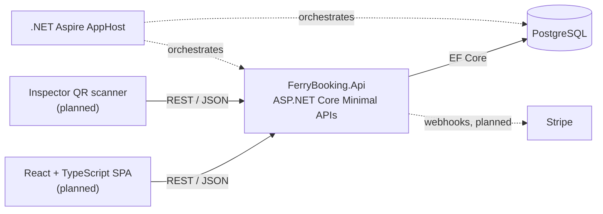

# SmartTicketing

[](https://github.com/dpentaris/SmartTicketing/actions/workflows/ci.yml)

A ferry ticket booking platform (code name `FerryBooking`) for Greek island routes: passengers search
sailings, reserve seats, pay online and receive a QR ticket that port inspectors
validate at boarding.

Built with **ASP.NET Core (.NET 10)**, **EF Core + PostgreSQL**, **.NET Aspire**
and (upcoming) **React + TypeScript** and **Stripe**.

> Work in progress. See the [roadmap](#roadmap) for what is done and what is next.

## Architecture



| Project | Purpose |
|---|---|
| `src/FerryBooking.Api` | HTTP API, organised in vertical slices (`Features/`), with a rich domain model (`Domain/`) and EF Core persistence (`Infrastructure/`). |
| `src/FerryBooking.AppHost` | .NET Aspire orchestration: starts PostgreSQL + pgAdmin in Docker and the API, with a dashboard for logs, traces and metrics. |
| `src/FerryBooking.ServiceDefaults` | Shared OpenTelemetry, health checks and resilience defaults. |
| `tests/FerryBooking.UnitTests` | Fast tests for domain rules (no database). |
| `tests/FerryBooking.IntegrationTests` | End-to-end API tests against a real PostgreSQL started by Testcontainers. |

Design decisions are recorded as [ADRs](docs/adr).

### Highlights

- **Domain rules in the domain**: entities are created through factory methods
  that enforce invariants (e.g. a sailing cannot depart in the past or arrive
  before it departs). Violations become `422 Unprocessable Entity`
  [problem details](https://www.rfc-editor.org/rfc/rfc9457).
- **Input validation** with .NET 10's built-in Minimal API validation (`400`).
- **Time zones done right**: timetables are in Greek local time; searching for
  "sailings on 1 October" uses Athens day boundaries, stored as UTC.
- **Real database in tests** via Testcontainers, shared once per test run.
- **OpenAPI** document with a [Scalar](https://scalar.com) UI in development.
- **CI** on every push: formatting check, build with warnings as errors, tests.

## Getting started

Prerequisites: [.NET 10 SDK](https://dotnet.microsoft.com/download) and
[Docker Desktop](https://www.docker.com/products/docker-desktop/) (running).

```bash
git clone https://github.com/dpentaris/SmartTicketing.git
cd SmartTicketing
dotnet run --project src/FerryBooking.AppHost
```

The Aspire dashboard opens in your browser. From there open the `api` resource
and navigate to `/scalar` to explore and call the API. The database is migrated
and filled with a two-week demo timetable on first start.

Run the tests (Docker must be running):

```bash
dotnet test
```

## API

| Method | Route | Description |
|---|---|---|
| `GET` | `/api/ports` | Ports served |
| `GET` | `/api/sailings?from=PIR&to=SDA&date=2026-10-01&passengers=2` | Search sailings for a day with enough free seats |
| `GET` | `/api/sailings/{id}` | Sailing details |
| `POST` | `/api/sailings` | Schedule a new sailing |

## Roadmap

- [x] Solution setup: Aspire, PostgreSQL, EF Core migrations, seed data
- [x] Timetable: ports, vessels, sailing search, scheduling
- [x] Unit + integration tests (Testcontainers), CI with GitHub Actions
- [ ] Authentication & roles (Customer, Inspector, Admin) with ASP.NET Core Identity
- [ ] Seat reservations with concurrency control (no overbooking)
- [ ] React + TypeScript frontend: search, booking, my tickets
- [ ] Stripe Checkout payments with webhook confirmation
- [ ] QR tickets and an inspector page that scans and validates them
- [ ] Deployment with a public demo

## License

[MIT](LICENSE)
